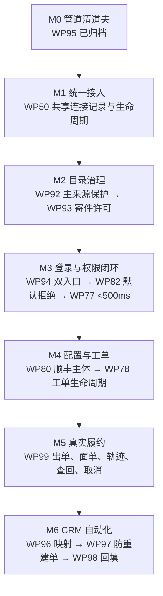

# Price-v3 系统主链治理章程与执行基线（Project Charter）

> 当前执行口径 IN-20261105-004：WP92组织目录整体同步与架构回读 → WP53持续同步、变更与恢复验收。部门、目录员工、主属/附属关系是一个业务整体；待关联账号的员工仍须可见。撤回部门与员工拆批建议，独立名册/导出退出前置，账号关联不阻断目录入库。下方历史排期与此冲突时，以本段、F099及active-task.json为准。开发、发布、生产写入分别判断。

- 版本：`2026-11-04.2`
- 授权来源：`IN-20261029-004`、`IN-20261103-004`、`IN-20261103-005`
- 状态：`Active`
- 当前唯一 Active：`WP92`
- 当前 Next：`WP53`
- 事实源：`governance/runtime-state/active-task.json`
- 适用范围：所有研发、产品、测试、运维、发布和生产验收活动

## 当前调度修订（IN-20261105-004）

WP92以一次完整组织目录同步和联动回读为唯一用户任务；WP53在其真实验收后验证持续变更与恢复。内部实现顺序不能拆成两个半套产品验收。旧范围/连接/差异独立排期不再驱动当前Active，现有基础按需要复用，未验收责任不自动关闭。

前一批缺真实证据，下一批不启动；代码、Preview和部署均不替代部门及人员关系的正式站真实回读。当前不混入SSO、登录、寄件、AI或下单，生产点击须先判断必要性及替代路径。

## 开发前案例回溯、优先复用与无死胡同红线（IN-20261105-020/021）

适用于所有功能的新建、修改、修复和复用。代码可编译不代表路径可交付；原案例在开发和验收时都必须回溯。

**IN-20261105-022澄清：开发过程允许分轮未完成，用户交付按承诺范围闭环。** 上下文轮次、内部步骤和提交不是独立业务交付；不要求每轮、每个技术步骤都闭环。可先模型和接口，再界面与必要异常处理；未完成部分记录承接事项后继续，不额外停工、扩展范围或逐轮请示。只在准备开放或宣称某项任务完成时，检查该任务及其必要依赖是否可用；不要求所有未来功能或所有异常场景一次完成。

开工先看与本次改动有关的用户案例/拓扑/边界、成熟案例和现有实现，形成适度的复用与差距判断；用户路径和状态设计可随实现逐步完善，交付前回放相关案例及关键失败路径。无需为每个微小步骤写完整合同。优先使用已有图文、代码和文档；研究生产端每次操作仍须评估效果、必要性和替代路径。

| 适用时点及产出 | 必须回答 | 未满足时如何处理 |
|---|---|---|
| 开工前：相关案例 | 本次改动与用户案例中的哪些关系、行为和限制有关 | 先做必要回溯，不要求研究全部未来案例 |
| 开工前：复用判断 | 已有能力在哪；本次要补哪个真实缺口 | 先查实现，避免未经判断重复造轮子 |
| 开发中：路径及状态设计 | 本次改动的入口、前提、影响、结果与后续依赖是什么 | 可分轮完善，记录已做/未做和下一步，不据此笼统停工 |
| 对外开放前：可用范围 | 此次承诺的任务能否完成，未开放能力是否被隔离或说明 | 修复必要断点，或限定为独立可用范围；不冒充整套完成 |
| 验收时：相关案例证据 | 正常路径及必要失败、取消、重试、刷新、重复和权限拒绝是否一致 | 不关闭未通过的任务；不受影响的独立范围另行判断 |

复杂用户任务可用：`案例依据 | 复用位置/缺口 | 角色/入口/条件 | 影响和结果 | 下一步/终态 | 关键异常 | 证据`。这是随开发补充的审查模板，不要求每个内部动作填写；小改动只记录相关内容，不为形式制造文档。

以下问题影响本次准备开放或宣称完成的任务时，否决该任务交付；不阻止继续开发、受控验证或不受影响的独立交付：

- 可见操作进入无法继续、无法返回或无法解释的状态；只能改库、运行脚本或求助开发者才能完成普通用户任务。
- UI、API、持久化事实互相矛盾，例如显示停用却仍应用数据，或提示成功却刷新丢失。
- 当前任务依赖后续未开放功能才能完成，仍把当前批次标为通过。
- 候选仅改标签或补孤立入口，未回放原案例、关联状态和失败出口。
- 因未研究现有实现而重复造轮子，或复用时照搬已知错误流程、过期约束和不适用的权限边界。

合法的权限拒绝、未开放能力及不可逆业务终态不是必须绕过的障碍：应给出准确原因、后果和授权范围内可行的处理方式；不自动提权、不虚构恢复能力。连接失败等异常不得悄悄覆盖最近一次有效业务数据。

后补内部实现、未开放能力、独立后续功能和非必要增强属于正常排期。WP92可以跨轮开发；只有准备宣称首次接入/整体同步可用时，其必要路径才必须完成。WP53保留后续维护任务，不能成为WP92缺少必要步骤却先宣称完成的理由，也不因全面恢复能力尚未实现就反向要求WP92包办未来范围。机器门禁、人工审查和正式站证据分别记录。

## 一、北极星总目标

在不新增、拆分或替换主数据库的前提下，以单一在制品（WIP=1）和正式站真实业务验收为硬约束，依次打通：

1. 全员纷享身份认证与系统授权；
2. 权限默认拒绝和关键页面性能；
3. 组织主数据、手工数据保护与寄件许可；
4. 顺丰配置、员工工单和真实履约；
5. CRM 审批字段映射、待确认建单与结果回填。

最终结果不是“代码已写”“CI 已绿”或“页面已部署”，而是授权用户在 `https://sales.cyanlog.icu` 上完成规定业务动作，并留下可复核证据。

## 二、三大刚性硬约束

| 维度 | 红线 | 一票否决条件 |
|---|---|---|
| 数据库 | 唯一业务库为 `cyanlog-sales-v3`；禁止新建数据库实例、拆库、增加异构主存储或以本地库充当业务真相源。允许在唯一库内执行经授权的可回滚结构迁移；本地临时存储只可用于可丢弃测试。 | 新建业务库、跨库主存储、未授权迁移、把本地临时数据冒充生产结果 |
| 生产操作 | 真实产生物流资费的顺丰建单必须由前台用户核对资料、服务和费用后二次确认；历史清理、不可逆覆盖、字段破坏性写入和主来源切换必须单独授权。 | 后台静默出号、未确认扣费建单、无授权覆盖历史/组织/权限数据 |
| 交付卡点 | 全局有且仅有一个 `Active`；所有任务串行推进；只有精确版本在正式站通过真实账号验收，且机器证据与操作员证据一致，才可进入 `Production_Released`。 | 多个 Active、跳过前置门禁、用代码/CI/Preview/main/部署动作冒充业务完成 |

## 三、交付状态机

```text
executing
→ code_green
→ clean_preview_green
→ integration_ready
→ main_integrated
→ production_released
```

- `code_green`：候选 SHA 的适用测试、类型检查、构建和安全门禁通过；只表示代码候选可用。
- `clean_preview_green`：隔离候选完成规定的真实用户路径；只作为发布前风险证据。
- `integration_ready`：交付证据绑定到精确 SHA，主干关系和回滚方式已核验。
- `main_integrated`：经批准的主干包含已发布代码；不代表域名已更新。
- `production_released`：Vercel Production 部署、域名指向、Production 运行证据、用户现有 Chrome 的真实业务验收和 delivery-check 全部绑定到同一 WP 与同一范围。

任何状态推进都必须使用 `delivery-record` 和 `delivery-transition`；涉及主干和正式发布时还必须通过 `delivery-seal` 与 `delivery-check`。没有证据时保持当前状态，不得写“大概完成”。

## 四、单线程排期流水线（WIP=1）



### M0：管道清道夫

- 任务：`WP95`。
- 已关闭范围：复杂文本拆分、村庄无门牌地址提交和缺项校验。
- 明确排除：真实工单提交、顺丰出号和履约。
- 当前记录：`Production_Released`，范围限定为解析与地址校验；生产 SHA 为 `74473851fb94ed2b0043f1a9dd04da4cc1a1ce0d`，部署证据为 `dpl_H1v7aeuYJK5TArDmpyAn5JSBMNry`。
- 归档后禁止重复开发；剩余顺丰履约只能进入 `WP99`。

### M1：统一组织连接底座

- 当前任务：`WP50`。
- 用户结果：管理员在组织来源页以同一套表单和同一张 `organization_sources` 连接记录配置飞书、纷享；未配置、已保存、验证失败、验证通过、已启用和已停用彼此可区分。
- 交付内容：
  1. 各 provider 只差异于凭据 schema、格式化、验证和目录协议，共享加密、版本、草稿/生效隔离、状态、审计和回滚；
  2. 保存或预览不启用来源、不写组织骨架、不切主来源、不复活 disabled 来源；新草稿验证失败时保留上一生效凭据；
  3. 旧飞书部署变量与纷享旧连接表只作为显式、一次性迁移输入，不能成为运行时双真相；
  4. 旧绑定/解绑 API 不再提供入口；启用、同步、主来源切换和停用留给 WP92 的差异确认与原子回滚。
- 准出：共享生命周期、迁移与 UI 目标回归通过；Production 迁移、启用、同步、切源和发布另获授权。WP50 通过不关闭 WP92、WP94 或 WP82。

### M2：组织主数据与寄件许可

- `WP92`：只消费 WP50 的已验证共享连接；纷享成为唯一外部主来源前，必须先展示新增、保留、冲突和停同步差异；旧飞书来源停同步但保留；手工创建的人员、部门、字段和历史关联不得删除或覆盖；冲突熔断；支持一键原子回滚。
- `WP93`：成员、部门、角色和寄件许可共享同一授权模型；停用、离职或撤权后的下一次请求立即拒绝；历史工单归属保持不变。

### M3：登录与权限闭环

- `WP94`：员工从纷享 OAuth 进入系统，按“提供方 + 企业 + 稳定外部员工 ID”映射到唯一系统成员；已批准的受限既有账号入口与纷享入口分别完成管理员/普通成员成功和拒绝矩阵。
- `WP94` 强制：随机一次性 `state`、短时 HttpOnly Cookie、固定回调、服务端企业校验、稳定映射 fail-closed；未映射、静默手机号绑定、停用、冲突和跨企业均拒绝。任何代码、Preview 或部署证据都不能替代现有 Chrome 的真实登录。
- `WP82`：模块默认拒绝、平台/租户角色拆分、默认角色、Owner、权限子集委托和拒绝审计保持独立验收；WP50 或 WP94 通过不能关闭它。
- `WP77`：首页冷启动和“自助收寄 → 配置中心”从点击到可操作时间必须小于 500ms；生产使用 P50/P95 记录，禁止页面首屏同步阻塞第三方 API。

### M4：顺丰配置与工单管理

- `WP80`：页面只允许一套绿色“当前生效”的顺丰连接；展示经核验的系统企业主体；历史订单继续使用原连接快照。
- `WP78`：员工工单默认展示五条并支持展开/收起；运单号加粗标红；退回原因明确；支持修改重提和取消；A/B 员工严格隔离。

### M5：顺丰真实履约

- 责任任务：`WP99`，作为“顺丰履约责任包”的唯一合法短 ID。
- 范围：真实费用核对、前台二次确认、只出号一次、电子面单、网络未知先查回、异常恢复、取消回执和 30 分钟轨迹刷新。
- 打印失败只重试打印；未知结果先查回；任何失败都不得导致重复建单。

### M6：CRM 自动化联动

- `WP96`：展示 CRM 审批实例字段到寄件行的动态映射和真实来源，缺字段逐项反馈。
- `WP97`：审批事件只生成一张待确认工单；重复通知、撤回、驳回、重审、跨人和跨租户正确处理。
- `WP98`：顺丰真实出号后回填原 CRM 审批记录；回填失败只重试回填，不重复下单。

## 五、每个 WP 的开工合同

任务进入 Active 前必须写清以下六项；缺一项不得开工：

```text
1. 唯一触发动作：用户从哪里执行什么操作
2. 确定性交付物：完成后用户能看到/完成什么
3. 显式拒绝规则：哪些输入、身份、租户和状态必须失败
4. 依赖与禁止扩张：依赖哪个 WP，明确不包含什么
5. 五类证据：开发、目标测试、隔离 Preview、精确 SHA Production、现有 Chrome 真实路径
6. 回滚与数据边界：失败如何恢复，是否涉及迁移、不可逆写入或真实资费
```

单 WP 预计超过一个工作日、跨两个独立业务域或包含两个可独立验收结果时必须拆批。新需求先进入 Inbox；只有用户看过影响评估并明确批准后才能替换当前 Active。

## 六、Backlog 物理归并矩阵

以下 21 个历史 WP 已迁入 `execution_queue.deprecated_merged`，不得继续独立开发。编号数量按矩阵明确枚举计算，不采用错误的“18 个”旧口径。

| 历史 WP | 唯一责任 WP | 唯一交付目标 |
|---|---|---|
| `WP63`, `WP22` | `WP95` | 复杂文本提取、字段拆分与无门牌村庄地址提交 |
| `WP61`, `WP70` | `WP82` | 路由、菜单和报表原子权限默认拒绝（403） |
| `WP69`, `WP57`, `WP60` | `WP77` | 服务端并发查询、精简预热、交互延迟小于 500ms |
| `WP62`, `WP68`, `WP81` | `WP92` | 纷享组织主来源、手工数据保护、冲突熔断与回滚 |
| `WP36`, `WP75` | `WP78` | 员工工单列表、退回原因、取消与重新提交 |
| `WP14`, `WP18`, `WP23`, `WP24`, `WP25`, `WP34`, `WP29`, `WP32`, `WP27` | `WP99` | 顺丰真实下单、面单、查回、恢复、取消和轨迹 |

历史注记：旧 F099 曾将 `WP61`、`WP70` 指向 `WP83`；该路由已被 `IN-20261029-004` 的最新矩阵取代，唯一责任包现为 `WP82`。旧记录只用于追溯，不再指导执行。

## 七、生产验收证据包

每个 WP 结项必须同时保留：

- WP 短 ID、唯一验收范围和精确 Production SHA；
- Vercel READY/PROMOTED deployment ID 与 `sales.cyanlog.icu` 指向；
- 真实账号类型、操作路径、输入、期望、实际、截图或 DOM/API 证据；
- 无权限、跨组织、重复请求和失败恢复路径；
- 数据写入、迁移和真实资费的独立授权记录；
- 回滚步骤及实际回滚结果；
- Git note、`origin/main` 包含关系、`delivery-status` 和 `delivery-check` 结果。

Git、CI、Preview、localhost、`*.vercel.app`、页面可打开、接口 200、部署记录或历史验收样本都不能单独关闭 WP。

## 八、当前执行基线（2026-11-03）

1. `WP95` 已按限定解析范围归档，释放 Active；不得重新打开其顺丰履约部分。
2. `execution_queue.deprecated_merged` 必须保持 21 条完整追溯记录；禁止为凑“18 个”删除任何历史 WP。
3. `WP52` 仅关闭逐票时效选择、批量应用和只读线上重放范围；Production SHA 为 `72a0fff0c313b8d2d583ef148c54b4c25b17647f`，部署为 `dpl_9vjCEGGoD23kMqLVS3XLYo4mewtG`。
4. 当前唯一 Active 为 `WP50`；本批只准备共享连接代码、迁移候选和本地证据，不执行 Production 迁移、启用/停用、同步、切源、账号/角色写入或发布。
5. 当前 Next 为 `WP92`，且只能在 WP50 达到其限定退出条件后进入；目录差异、主来源切换和回滚仍是独立产品验收。
6. `WP94`、`WP82`、`WP77`、`WP65` 等候选或库存均未关闭；真实登录、权限、性能和现有成果整合仍分别验收，不能由 WP50/WP52 结果推导完成。
7. 所有配置必须直连唯一项目 `cyanlog-sales-v3`；临时测试只可本地丢弃，不得产生第二业务库。
8. 任何新的多意图输入先拆分为关联 Inbox 事项；不得再次把架构红线、安全约束、排期和 Backlog 混写成一个复合目标。
